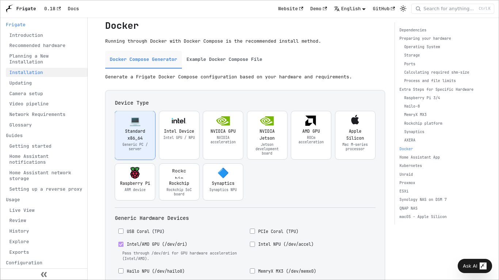

# Trabalho de Conclusão de Curso
# CFTV/IP com virtualização de NVR (Frigate)

## Contexto
O Trabalho de Conclusão de Curso (TCC) consistia em estruturar uma rede completa, com todos os componentes e serviços mais comuns, como switches (core e distribuição), firewall, proxy, roteadores, servidor (GIT, NVR, LDAP, Monitoramento). O nosso grupo estava encarregado da configuração e implementação do CFTV/IP, utilizando um serviço de NVR virtualizado: o Frigate.

## Solução implementada
### Frigate
Frigate é uma solução open source para implementação de um NVR (Network Video Recorder) de maneira virtualizada baseada em docker.

### Servidor
Para implementar o Frigate é preciso primeiramente de um servidor. Recomenda-se utilizar um servidor Debian 12 dedicado bare metal, mas sendo possível usar máquinas virtuais ou contêiners (LXC) com perca de performance.

[Guia para instalação do Debian 12](https://www.debian.org/releases/bookworm/amd64/index.pt.html)

### Instalação
Após a configuração do servidor, faça acesso à sua máquina e instale o Docker
```bash
apt update && apt upgrade
apt install docker
```
Depois que o Docker for instalado com sucesso crie os diretórios de configuração e armazenamento. Ex:
```bash
mkdir ~/config
mkdir ~/media
```
Com os diretórios criados, acesse o site de [documentação do Frigate](https://docs.frigate.video), e na aba "Install" faça o [cálculo do tamanho do SHM](https://docs.frigate.video/frigate/installation#calculating-required-shm-size) e [crie seu arquivo Docker](https://docs.frigate.video/frigate/installation#docker) de acordo com seu hardware e preferências.



Após a obtenção do arquivo docker-compose.yml, copie-o para o seu servidor/máquina e utilize o seguinte comando para instalar e habilitar o serviço:
```bash
docker compose up -d
```
(Obs.: Após a execução do comando fique atento, pois o usuário e senha padrão da instalação aparecerão nos logs/terminal.)
